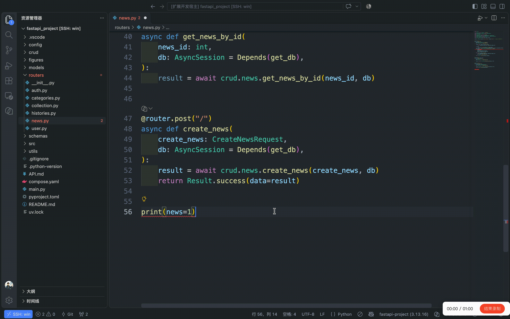

<p align="center">
  
</p>

# CodeRef

[中文](README.md)

Copy a citation for the cursor's line or selected source lines, or copy the red errors on the cursor's line.



## Commands

| Command | Mac | Windows / Linux |
| --- | --- | --- |
| Copy code citation | `Cmd+Shift+C` | `Ctrl+Shift+C` |
| Copy diagnostic citation | `Cmd+Shift+X` | `Ctrl+Shift+X` |

Status-bar text is still Chinese:

| Situation | Status bar |
| --- | --- |
| Code citation copied | `已复制代码引用` |
| One diagnostic copied | `已复制诊断引用` |
| Several diagnostics copied | `已复制 3 条诊断引用` |
| No editor, or no file path | `无法生成引用` |
| No red error on this line | `没有可复制的诊断` |

## Code citation

A normal file is a workspace-relative path plus a 1-based line number. One line, no trailing newline:

```
fixtures/03_longterm_memory.py:17
```

For a multi-line selection, the citation includes a line range, for example `fixtures/persist_diagloge.py:7-8`. A selection ending at the start of the next line excludes that line.

`.ipynb` does not use the JSON line numbers on disk. It uses cell coordinates. `N` is the 1-based index of every cell (markdown included). `L` is the 1-based line inside that cell. Multi-line selections use the same line-range notation:

```
notes/demo.ipynb:cell3:17
notes/demo.ipynb:cell3:17-18
```

Select one or more whole notebook cells and use the copy code citation shortcut to generate one citation per selected cell, in document order, covering all lines in each cell. When editing cell text, the citation still follows the text selection or cursor line.

## Diagnostic citation

Only diagnostics whose severity is Error are copied. A warning is excluded even if the theme paints it red. A range is copied when it overlaps the primary cursor's line; the cursor does not have to sit on the squiggle. The line number is the diagnostic's start line, not the cursor line. Several diagnostics on the same line are ordered by start column. Equal start positions keep VS Code's order.

The message is kept as-is. `code` keeps a string value; a number is written in decimal. Related locations and documentation links are omitted. A missing source or code is left out.

```
persist_diagloge.py:15 “create_agent”的重载与提供的参数不匹配
  参数类型:(BaseChatModel, SqliteSaver)
Pylance reportCallIssue
```

A blank line separates multiple citations. There is no trailing blank line. Notebook diagnostics use the same cell coordinates, for example `persist_diagloge.ipynb:cell3:15`.

## Run locally

```sh
npm install
npm test
```

Open this folder in VS Code, press F5, and choose **Run CodeRef**. Try it in the Extension Development Host that opens.
