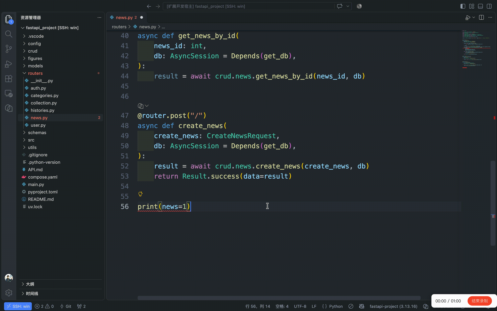

<p align="center">
  
</p>

# CodeRef

[English](README.en.md)

复制编辑器中光标所在行或选中的多行源码的引用，或光标所在行上的红色错误。



## 命令

| 命令         | Mac           | Windows / Linux |
| ------------ | ------------- | --------------- |
| 复制代码引用 | `Cmd+Shift+C` | `Ctrl+Shift+C`  |
| 复制诊断引用 | `Cmd+Shift+X` | `Ctrl+Shift+X`  |

| 情况                       | 状态栏                |
| -------------------------- | --------------------- |
| 复制了代码引用             | `已复制代码引用`      |
| 复制了 1 条诊断            | `已复制诊断引用`      |
| 复制了多条诊断             | `已复制 3 条诊断引用` |
| 没有编辑器，或没有文件路径 | `无法生成引用`        |
| 这一行没有红色错误         | `没有可复制的诊断`    |

## 代码引用

普通文件是工作区相对路径加 1-based 行号，单行，末尾不加换行：

```
fixtures/03_longterm_memory.py:17
```

选中多行时，引用包含行范围，例如 `fixtures/persist_diagloge.py:7-8`。选区结束于下一行行首时，不包含该行。

`.ipynb` 不用磁盘上的 JSON 行号，而用单元格坐标。`N` 是全部单元格（含 markdown）的 1-based 序号，`L` 是该单元格内的 1-based 行号；多行选区同样使用行范围：

```
notes/demo.ipynb:cell3:17
notes/demo.ipynb:cell3:17-18
```

在笔记本中选中一个或多个完整单元格后，按复制代码引用快捷键，会按文档顺序为每个选中的单元格生成一行引用，包含该单元格的全部行。编辑单元格文本时，仍按文本选区或光标行生成引用。

## 诊断引用

只复制严重级别为 Error 的诊断。警告即使被主题画成红色也不算。范围只要和主光标所在行有重叠就复制，不要求光标正好在波浪线上。行号用诊断的起始行，不是光标行。同一行多条按起始列排序，起始位置相同则保持 VS Code 的顺序。

消息原样保留。`code` 只取字符串值，数字写成十进制。不附相关位置，不附文档链接。缺来源或代码就省掉那一项。

```
persist_diagloge.py:15 “create_agent”的重载与提供的参数不匹配
  参数类型:(BaseChatModel, SqliteSaver)
Pylance reportCallIssue
```

多条之间空一行，最后不加空行。笔记本里的诊断同样使用单元格坐标，例如 `persist_diagloge.ipynb:cell3:15`。

## 本地运行

```sh
npm install
npm test
```

用 VS Code 打开本目录，按 F5，选择 **Run CodeRef**。在新开的扩展开发宿主里试。
